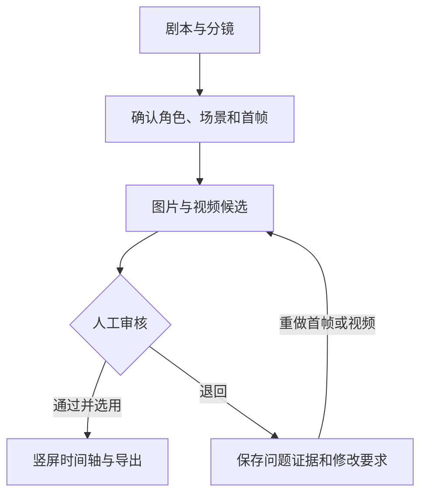

# 《下一班车》AI 漫剧创作工作台

面向小型内容团队的竖屏漫剧制作系统。创作者从一段故事起稿，整理剧本、角色、场景和分镜，逐镜制作关键帧和视频。审核员根据角色参考和画面证据决定通过、退回或选用哪个版本。系统按已选镜头拼接和导出约一分钟的 9:16 成片。

[**公开审核演示**](https://next-bus-shot-review.riferice4.chatgpt.site/) · [**一分钟试映 MP4**](https://raw.githubusercontent.com/Dongye-Yuan/next-bus-shot-review/main/docs/assets/next-bus-60s.mp4) · [**功能详解**](docs/features.md) · [**团队工作区（需授权）**](https://next-bus-team-review.riferice4.chatgpt.site/)

[](https://raw.githubusercontent.com/Dongye-Yuan/next-bus-shot-review/main/docs/assets/next-bus-60s.mp4)

## 三分钟看懂项目

| 想看什么 | 从哪里开始 |
| --- | --- |
| **一分钟的最终交付是什么样** | 下载上方 MP4。《下一班车》由 10 个镜头组成，时长约 60 秒，720 × 1280。它使用已有视频和由静帧制作的运镜素材。 |
| **同一角色怎么保持一致** | 打开公开演示，选**镜头 03**。对比许棠两张侧脸图。黄色发夹固定在她**本人右侧**，旧版把发夹画到了左侧。可退回旧版并保留已选修正版。 |
| **问题镜头怎么返工** | 选**镜头 04**，查看开伞原版、失败样片和共伞替代版。退回失败样片，再选用已通过的共伞版。预览跳到 **00:12**，刷新后仍能看到选用状态。共伞版是经审核通过的替代镜头，完整开伞动作的失败样片也保留用于对照。 |

公开演示无需登录，提供 4 镜、约 17 秒的审核样例，记录保存在当前浏览器。团队站包含完整创作入口、共享审核和十镜试映项目，需要团队授权。公开演示的镜头 03、04 分别对应一分钟试映的镜头 04、05。[逐步演示](docs/demo.md)

## 功能速览

| 功能 | 创作者可以做什么 |
| --- | --- |
| [保存故事与拆剧本](docs/features.md#story) | 输入故事或小说片段，用规则或文字模型起草，逐场修改并确认。 |
| [角色与场景设定](docs/features.md#settings) | 从已确认剧本整理角色和场景，补写外观、服装、布局、光照及道具。 |
| [参考图与角色一致性](docs/features.md#references) | 保存角色三视角和场景参考版本，指定每镜使用的角色、版本和视角。 |
| [分镜拆解与镜头编辑](docs/features.md#storyboard) | 按目标时长起草分镜，编辑角色、场景、动作、对白等字段，确认后建镜。 |
| [可视化分镜板](docs/features.md#visual-board) | 按时间轴查看每镜画面、参考版本、关键帧状态和待复核提示。 |
| [图片和关键帧](docs/features.md#keyframes) | 生成或导入候选图，通过初审后确认关键帧，供视频生成引用。 |
| [视频生成与任务管理](docs/features.md#generation) | 用确认首帧生成视频，查看任务状态，完成后收回为待审版本。 |
| [角色与画面质量检查](docs/features.md#quality) | 复核角色特征、动作、道具和遮挡等问题，点提示查看角色参考与证据帧。 |
| [Colab 检查包](docs/features.md#check-package) | 导出参考图和抽帧，到 Colab 检查，再把报告导回对应素材版本。 |
| [镜头审核、返工与选版](docs/features.md#rework) | 退回并保留原版，带着问题记录生成或导入修订版，确认后更新成片。 |
| [竖屏预览与导出](docs/features.md#export) | 按镜头顺序播放、跳转和检查时长，导出 9:16 MP4 及审核记录。 |
| [项目、权限与协作](docs/features.md#workspace) | 建多个项目，在共享工作区管理镜头、素材、成员角色和审核历史。 |

## 从故事到成片

**故事原文 → 剧本确认 → 角色与场景确认 → 分镜确认 → 关键帧确认 → 视频审核与选用 → 竖屏 MP4**

生成结果进入候选或待审状态。创作者可改文字草稿、参考版本、生成要求或关键帧。通过审核与选入成片是两次操作，时间轴只读取当前选用版本。



## 当前交付与验证

- **可直接体验**。公开四镜审核、镜头版本切换、约一分钟的试映 MP4。团队站的角色和场景绑定、分镜修改、关键帧换版、预览和导出已有实现。
- **有真实样片证据**。真实 Gemini 离线小样用于检查发夹、眉疤的左右一致性。历史失败视频用于展示实际的遮挡问题。新检查包的导出、模拟结果回导和证据跳转已验证。样片规模见[演示与验证记录](docs/demo.md#verification)。
- **需要启用外部服务**。站内文字起稿和视觉抽检已接入 OpenAI 或 Gemini。关键帧和视频任务已接入 fal，可分别启用。正式站未配置这些外部服务密钥，真实站内调用与自动重生成尚未验收。现阶段可用规则草稿、外部工具提示词、素材导入和 Colab 检查包继续制作。

## 本地运行与部署

公开版仅需 Python。在仓库根目录运行：

```bash
python3 -m http.server 8000 --directory dist
```

访问 [http://localhost:8000](http://localhost:8000/)。可重新选版、刷新保留记录、导入本地素材和导出审核 JSON。

团队版使用原生 JavaScript、Sites Worker、D1 和 R2。构建和测试使用 Node.js（本次使用 26.8.1），团队版示例配置仅列出绑定名称。

```bash
cd team
npm test
cp .openai/hosting.example.json .openai/hosting.json
npm run build
```

已有本地托管配置时保留原文件，构建输出位于 `team/dist/server/index.js`。部署、数据库迁移、成员角色和服务密钥名称见[团队版运维文档](team/README.md#部署配置)。密钥在部署平台保存为服务端 Secret。

| 路径 | 内容 |
| --- | --- |
| [`dist/`](dist/) | 公开演示、浏览器本地审核与四镜样片 |
| [`team/client/`](team/client/) | 故事、分镜、参考图、审核、预览与导出的界面 |
| [`team/worker/`](team/worker/) | 项目读写、版本、审核、模型与生成任务接口 |
| [`team/drizzle/`](team/drizzle/) · [`team/test/`](team/test/) | 存储迁移与回归测试 |
| [`examples/`](examples/) · [`docs/`](docs/) | 可粘贴的故事和分镜示例、功能手册、验证记录与成片 |
